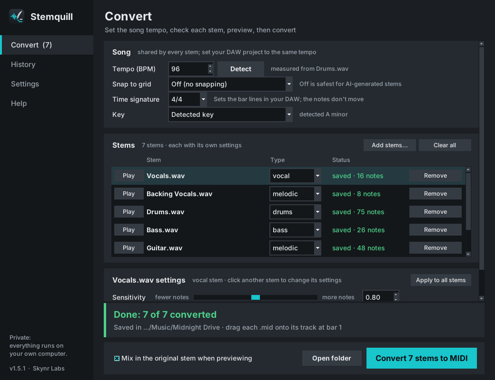

#  Stemquill

[](LICENSE)
[](https://apps.microsoft.com/search?query=Stemquill)
[](https://skynrlabs.itch.io/stemquill)

[](https://discord.gg/25mPUWUAa)

> Turn audio stems into MIDI for any DAW.  
> Drums, bass, vocals, keys and synths, ready to play through your own instruments.

<p>
  <a href="https://apps.microsoft.com/search?query=Stemquill"></a>
</p>

$4.99 on the [Microsoft Store](https://apps.microsoft.com/search?query=Stemquill): signed by Microsoft, installs in one click, updates itself and includes better chord detection. Prefer a regular installer, or on a Mac or Linux? Get it on [itch.io](https://skynrlabs.itch.io/stemquill) and pay what you want (Windows, Mac and Linux).



---

## What Is Stemquill?

Stemquill is a desktop tool that listens to an audio stem and writes out what it hears as a MIDI file. Drop in a drum stem and you get kick, snare, hats, toms and cymbals on the right notes for your drum plugin. Drop in a bass or vocal stem and you get the melody line. Guitar, keys and synth stems come out as chords.

It's made with AI stems in mind: drop in a whole folder of Suno stems and each one gets the right type and a matching instrument sound, and slightly off-pitch AI vocals still come out as the notes that were sung.

Drag the `.mid` file into Waveform, FL Studio, Ableton, Reaper, Logic, Cubase or any other DAW, put your own instrument on it, and the part is yours to play, edit and rework.

---

## 💬 Why Stemquill?

Stem separators are everywhere now, but a stem is still just audio. You can't swap the drum kit, fix one wrong note or change the groove. I wanted a simple way to get from "I have the stem" to "I have the part" so I could rebuild it with my own sounds in my own DAW.

Stemquill is the bridge: audio in, MIDI out, with a preview so you can hear the result before you save it.

---

## ✨ Features

- 🥁 **Full drum kit detection**: kick, snare, closed and open hi-hat, high/mid/low toms, crash and ride
- 🎸 **Melodic stems**: bass and vocal lines as single notes, guitar, keys and synths as chords
- 🎤 **Natural vocals and bass**: corrects a voice that sits a little sharp or flat, holds notes through vibrato, and keeps slides as two notes instead of a run of short ones
- 🏷️ **Knows your stems**: Suno's stem names (Vocals, Backing Vocals, Drums, Percussion, Bass, Guitar, Keyboard, Strings, Brass, Woodwinds, Synth, FX) pick the right type and a matching instrument sound in your DAW
- ⏱️ **Tempo detection**: measures the real BPM from a stem so your MIDI lines up with your DAW grid
- ▶️ **Preview before saving**: play any stem from its row with built-in sounds, with the original stem mixed in to check the timing
- 🎚️ **Humanize**: small timing and velocity changes so parts feel played, not programmed
- 🗺️ **Drum maps**: General MIDI (MT Power Drumkit, EZdrummer, Addictive Drums, Superior Drummer), pads in order (FL Studio FPC, Ableton Drum Rack, MPC) or your own custom notes
- 🎛️ **Per-stem settings**: sensitivity, humanize and drums for each stem, with Apply to all
- 📐 **Snap to grid**: keep the original feel or lock notes to 1/8, 1/16 or triplets
- 🎼 **Time signature**: 4/4, 3/4, 6/8, 7/8 and more, so the bar lines land in the right place in your DAW
- 🔑 **Key detection and snap to key**: finds the song's key and pulls stray out-of-key notes into it, which fixes many wrong notes in one go
- 🎹 **Chord names**: chord stems carry their chords (C, Am, G7...) as markers along your DAW's timeline
- 🗂️ **One file for the whole song**: every stem on its own named track, with its own instrument, in `<song> - all stems.mid`
- 🧠 **Remembers your settings**: the next Drums, Bass or Vocals stem you add starts with the settings you used last time
- 📦 **Drag and drop**: drop stems or a whole folder onto the window and convert them in one go
- ✅ **Always know where you stand**: each stem shows when it's saved, and says *changed · convert again* if you tweak it afterwards
- 🧭 **Clean navigation**: sidebar pages and keyboard shortcuts
- 💻 **GUI and command line**: point and click, or script it

---

## 📥 Install

### Windows: Microsoft Store (recommended)

1. Open **[Stemquill on the Microsoft Store](https://apps.microsoft.com/search?query=Stemquill)** and buy it ($4.99 USD, or the local price where you are).
2. Open **Stemquill** from the Start menu.

The Store version is signed by Microsoft, so there's no security warning, it includes better chord detection, and it **updates itself** automatically. Every update is free. To remove it, use **Settings → Apps → Stemquill → Uninstall**.

### Windows: installer from itch.io

1. Download **`Stemquill-Setup-x.y.z.exe`** from [itch.io](https://skynrlabs.itch.io/stemquill) (pay what you want; $4.99 USD suggested).
2. Run it and click through the installer. No Python or admin rights needed. On the **Additional tasks** page, keep **Better chord detection** ticked for more accurate chords on guitar, keys and synth stems (it adds about 45 MB).
3. Open **Stemquill** from the Start menu (or the desktop shortcut, if you ticked it).

> Windows may show **"Windows protected your PC"** because this installer isn't code-signed. Click **More info → Run anyway**, or get the signed version from the [Microsoft Store](https://apps.microsoft.com/search?query=Stemquill).

To update, run the newer installer. To remove, use **Settings → Apps → Stemquill → Uninstall**.

### Mac: app from itch.io

1. Download the Mac zip from [itch.io](https://skynrlabs.itch.io/stemquill) (pay what you want; $4.99 USD suggested). Pick **Apple Silicon** if **Apple menu → About This Mac** says Apple M1 or newer, or **Intel** if it says Intel.
2. Open the zip and drag **Stemquill** into your **Applications** folder. No Python needed.
3. Open **Stemquill** from Applications.

The Mac app is signed and notarized by Apple, so it opens without a security warning. It needs macOS 14 (Sonoma) or newer. The Apple Silicon version includes better chord detection built in. The Intel version uses Stemquill's own chord detection, because the library behind better chord detection no longer supports Intel Macs. To update, replace the old Stemquill in Applications with the new one; your settings are kept.

### Linux: app from itch.io

1. Download **`Stemquill-x.y.z-linux-x86_64.tar.gz`** from [itch.io](https://skynrlabs.itch.io/stemquill) (pay what you want; $4.99 USD suggested).
2. Unpack it and run **`./install.sh`** inside the folder. No sudo or Python needed: it installs into your home folder and adds **Stemquill** to your app menu, plus a `stemquill` command.
3. Open **Stemquill** from your app menu, or run `stemquill`.

Works on most 64-bit desktop distributions from 2022 onwards (Ubuntu 22.04, Debian 12, Fedora 36, Mint 21 and newer). To update, unpack the new version and run `./install.sh` again; your settings are kept. To remove it, run `~/.local/share/stemquill/install.sh --uninstall`.

### Better chord detection (optional)

[basic-pitch](https://github.com/spotify/basic-pitch) improves chords on guitar, keys and synth stems. On Windows, it's the **Better chord detection** box in the installer; run the installer again to add or remove it. The Mac app for Apple Silicon has it built in. The Linux app and the Intel Mac app use Stemquill's own chord detection.

---

## ⚙️ How It Works

Everything happens on the **Convert** page, top to bottom:

1. **Drop your stems** (or a whole folder of them) onto the window, or click **Add stems...** (WAV, MP3, FLAC, AIFF, OGG or M4A). Each stem gets its own row. Its type is read from the file name (see [Stem names](#-stem-names)); change it in the row if needed.
2. **Song:** click **Detect** to measure the tempo from the selected stem and find the song's key, or type the BPM. Tempo, **Snap to grid**, **Time signature** and **Key** are shared by every stem, because it's one song. Get the tempo right: it decides which beat each note lands on. Set **Key** to **Detected key** (or pick the key) to pull out-of-key notes into it; drums are never changed.
3. **Click a stem** to see its own settings underneath: **Sensitivity**, **Humanize** and, for drum stems, which drums to write and the drum map. **Apply to all stems** copies them to the rest.
4. Click **Play** on a stem's row to hear it with built-in sounds; the button turns into **Stop** while it plays. Keep **Mix in the original stem** ticked to check the timing against the real audio.
5. Click **Convert … to MIDI** (it says how many stems). Each row shows when its file is saved as `<name> - <type>.mid`. Change a setting afterwards and the row says **changed · convert again**, so you never drag an out-of-date file into your DAW.

**History** lists everything Detect, Play and Convert did; double-click a saved file to open its folder.

**Settings** holds where files are saved (next to each stem by default), whether the folder opens when converting finishes, whether to also save the whole song in one file and to write chord names, the drum note numbers (see [Drum Maps](#-drum-maps)), and **Reset everything to defaults** (which also forgets the settings remembered for each kind of stem).

Then set your DAW project to the same tempo and drag each `.mid` onto its instrument track at bar 1, or drag in `<song> - all stems.mid` to get every stem on its own track at once. The song name comes from what the stems' names have in common (`Midnight Drive (Vocals).wav`...) or else their folder.

| Stem type | What you get |
|---|---|
| `drums` | Drum hits on MIDI channel 10, mapped to your drum plugin |
| `bass` | The bass line as single notes |
| `vocal` | The lead vocal melody as single notes |
| `melodic` | Guitar, keys, fiddle and chords (several notes at once) |
| `synth` | Synths and pads (several notes at once) |

### 🏷️ Stem names

Stemquill reads the stem's file name to pick its type and the instrument sound your DAW plays it with. The names cover Suno's stems and the usual names from other splitters:

| File name contains | Type | Sound in your DAW |
|---|---|---|
| Drums, Percussion | `drums` | Your drum plugin (channel 10) |
| Bass | `bass` | Fingered bass |
| Vocals, Vox, Voice | `vocal` | Choir |
| Backing Vocals, Harmony, Choir | `melodic` (harmonies are chords) | Choir |
| Synth, Pad | `synth` | Pad |
| Keyboard, Keys, Piano | `melodic` | Piano |
| Organ | `melodic` | Organ |
| Strings, Violin, Cello | `melodic` | Strings |
| Brass, Trumpet, Horn | `melodic` | Brass |
| Woodwinds, Flute, Clarinet | `melodic` | Flute |
| Sax | `melodic` | Sax |
| Guitar, or anything else | `melodic` | Guitar |
| FX | `synth` (with a note that sound effects rarely make useful MIDI) | Pad |

Change a stem's type by hand and it gets that type's usual sound.

### ⌨️ Keyboard shortcuts

| Keys | Action |
|---|---|
| `Ctrl+O` | Add stems |
| `Ctrl+T` | Detect tempo and key |
| `Ctrl+P` | Preview the selected stem |
| `Esc` | Stop playback |
| `Ctrl+Enter` | Convert to MIDI |
| `Ctrl+1` to `Ctrl+4` | Convert, History, Settings, Help pages |
| `F1` | Help |

---

## 💻 Command Line

For batch jobs and scripts. The command line comes with the Linux app (the `stemquill` command); the Windows app is window-only. Leave out `--bpm` and the tempo is detected for you.

```bash
stemquill "Drums.wav" --type drums --bpm 121 --grid 0 --drum-parts kick,snare,toms
stemquill "Drums.wav" --grid 4 --humanize 30
stemquill "Drums.wav" --bpm 121 --drum-map pads
stemquill "Drums.wav" --bpm 121 --map kick=35,snare=40
stemquill "Bass.wav" "Other.wav" --bpm 121 --grid 0
stemquill *.wav --bpm 121 --key auto --song-file
```

| Option | What it does |
|---|---|
| `--type` | `auto`, `drums`, `bass`, `vocal`, `melodic` or `synth` |
| `--bpm` | Song tempo (detected if left out) |
| `--grid` | Snap steps per beat: `4` = 1/16, `2` = 1/8, `3` = triplets, `0` = off |
| `--sensitivity` | `0.1` (fewer notes) to `1.5` (more notes), default `0.8` |
| `--humanize` | `0` (exact) to `100` (loose) |
| `--time-sig` | Time signature for the bar lines, e.g. `3/4`, `6/8`, `7/8` (default `4/4`) |
| `--key` | Pull out-of-key notes into the key: `off` (default), `auto` (detect it from the stems), or a key like `"A minor"`, `F#`, `Bbm` |
| `--song-file` | Also save every stem as its own track in one file: `<song> - all stems.mid` |
| `--no-chord-names` | Don't write chord names as markers in chord stems |
| `--drum-parts` | Any of `kick,snare,hihat,openhat,toms,crash,ride` |
| `--drum-map` | `gm` (General MIDI) or `pads` (one pad per drum from note 36) |
| `--map` | Custom notes, e.g. `kick=36,snare=40` |
| `--out` | Folder for the `.mid` files |

---

## 🥁 Drum Maps

| Drum | General MIDI | Pads in order |
|---|---|---|
| Kick | 36 | 36 |
| Snare | 38 | 37 |
| Closed hi-hat | 42 | 38 |
| Open hi-hat | 46 | 39 |
| Low tom | 43 | 40 |
| Mid tom | 45 | 41 |
| High tom | 48 | 42 |
| Crash | 49 | 43 |
| Ride | 51 | 44 |

**General MIDI** works with MT Power Drumkit 2, EZdrummer, Addictive Drums, Superior Drummer, Steven Slate Drums and most drum plugins. **Pads in order** is for pad samplers: load your sounds onto the pads in the order above. Choose **Custom** to type any note, and your map is remembered for next time.

Some DAWs name octaves differently, so the same kick note can show as C1 or C2. It's only a label; the note number is the same.

---

## 💡 Tips

- Automatic transcription is a starting point, not a finished part. Expect to fix some notes, especially toms, ghost notes and busy strumming.
- Cleaner stems give better results. Bleed from other instruments means extra notes.
- AI-generated songs often play at a slightly different tempo than the prompt asked for. Use **Detect** rather than trusting the prompt.
- Crash and Ride start unticked because cymbals can bring back metallic sounds. Turn them on if your stem has clear cymbals.
- Side-stick, bell, china and left/right crash aren't detected, so add them by hand where you want them.
- The preview uses simple placeholder sounds. Your real drum kit or synth will sound much better.

---

## 🩺 Troubleshooting

| Problem | Fix |
|---|---|
| **"Windows protected your PC"** when installing | That's the itch.io installer, which isn't code-signed. Click **More info → Run anyway**, or install the signed version from the [Microsoft Store](https://apps.microsoft.com/search?query=Stemquill). |
| The Mac app won't open | Make sure you dragged it into **Applications** first and are on macOS 14 or newer. If a message says it couldn't start, send the crash report from `~/Library/Application Support/Stemquill/crash.log` in [an issue](https://github.com/skynrlabs/Stemquill/issues). |
| Not sure which Mac download you need | **Apple menu → About This Mac**: Apple M1, M2, M3 or newer is **Apple Silicon**; otherwise it's **Intel**. |
| The Linux app won't start | Run `stemquill` in a terminal to see the error, and send it in [an issue](https://github.com/skynrlabs/Stemquill/issues). Very old distributions (before 2022) aren't supported. |
| The first start is slow | Normal after installing: Windows checks every new file first, and the "Starting Stemquill..." window shows it's on its way. Later starts are much quicker. |
| Stemquill won't open | End any **Stemquill.exe** in Task Manager and try again. If a message says it couldn't start, send the crash report from `%APPDATA%\Stemquill\crash.log` in [an issue](https://github.com/skynrlabs/Stemquill/issues). |
| "Drag and drop is off for now" | On some PCs Windows gets stuck turning on drag and drop, so Stemquill started without it. Use **Add stems...**; it tries again after a week, and restarting your PC usually clears it sooner. |
| MIDI drifts out of time in the DAW | The project tempo doesn't match. Click **Detect** and set your DAW to that exact BPM. If it's half or double what you expect, use the number that matches the song's feel. |
| Too many junk notes | Click the stem and lower its **Sensitivity** (try 0.6); for drums, untick the drums you don't need. |
| Missing quiet notes | Click the stem and raise its **Sensitivity** (try 1.0). |
| Chords look messy or simplified | Make sure **Better chord detection** was ticked when installing (run the installer again to add it). The **History** page says which chord engine was used. |
| Drums land on the wrong sounds | Pick the drum map that matches your plugin (in a drum stem's settings), or type your own note numbers on the **Settings** page. |
| No sound when previewing | Check your output device and volume. If it can't play, the status card shows where the preview file was saved. |

Still stuck? [Open an issue](https://github.com/skynrlabs/Stemquill/issues) with your settings and, if you can share it, a short clip of the stem.

---

## 🔐 Privacy

Stemquill runs entirely on your computer. Your audio is never uploaded anywhere. Besides your MIDI files, it only writes a small `settings.json` with your settings (and a `crash.log` if something goes wrong) in `%APPDATA%\Stemquill` on Windows, `~/Library/Application Support/Stemquill` on macOS or `~/.config/stemquill` on Linux, plus a cache of the audio library's compiled code in your own cache folder. Nothing is sent anywhere, crash reports included: you choose whether to share one.

---

## 💚 Support Stemquill

Stemquill is made by one person. If it saves you time, you can buy it for $4.99 on the [Microsoft Store](https://apps.microsoft.com/search?query=Stemquill) or pay what you want on [itch.io](https://skynrlabs.itch.io/stemquill), or sponsor Skynr Labs on [GitHub Sponsors](https://github.com/sponsors/skynrlabs). It keeps new features coming. A rating or review on the [Microsoft Store](https://apps.microsoft.com/search?query=Stemquill), starring the repo, and sharing it with other producers all help too.

---

## 🐞 Bugs and ideas

Found a bug, a sound problem, or have an idea? [Open an issue](https://github.com/skynrlabs/Stemquill/issues/new/choose). This repo is where Stemquill is released and supported; the source code itself is private.

## 💬 Community

Join the [Skynr Labs Discord](https://discord.gg/25mPUWUAa) to ask questions, report bugs, share what you've made and hear about new releases. It's one server for all the Skynr Labs apps: Hearthloop, WavMasta, Stemquill and SemaBuzz.

## 📄 License

Stemquill is proprietary software under the [Stemquill License](LICENSE). Copyright © 2026 Skynr Labs.

- **You can** install and use Stemquill on computers you own or control, whatever you paid for it.
- **The music is yours.** MIDI you make with Stemquill is yours to use however you like, commercial releases included.
- **You can't** share, publish or sell Stemquill, changed or not, without written permission. Point people to [itch.io](https://skynrlabs.itch.io/stemquill) or the [Microsoft Store](https://apps.microsoft.com/search?query=Stemquill) instead.

Earlier versions released under the MIT License stay under it. See [LICENSE](LICENSE) for the full terms.

### Third-party libraries

Stemquill is built on [librosa](https://librosa.org) (ISC), [NumPy](https://numpy.org) and [SciPy](https://scipy.org) (BSD), [soundfile](https://github.com/bastibe/python-soundfile) (BSD, with libsndfile under the LGPL), [mido](https://github.com/mido/mido) and [tkinterdnd2](https://github.com/Eliav2/tkinterdnd2) (MIT), and the libraries they use. The optional chord add-on uses [basic-pitch](https://github.com/spotify/basic-pitch) (Apache 2.0) and [ONNX Runtime](https://onnxruntime.ai) (MIT).

The Windows, Mac and Linux apps include every bundled library's license in full as `THIRD_PARTY_LICENSES.txt`, and you can read it in the app under **Help → About → Open-source licenses**.

---

Made by [Skynr Labs](https://github.com/skynrlabs) &nbsp;·&nbsp; [Microsoft Store](https://apps.microsoft.com/search?query=Stemquill) &nbsp;·&nbsp; [itch.io](https://skynrlabs.itch.io/stemquill) &nbsp;·&nbsp; [GitHub Sponsors](https://github.com/sponsors/skynrlabs)
